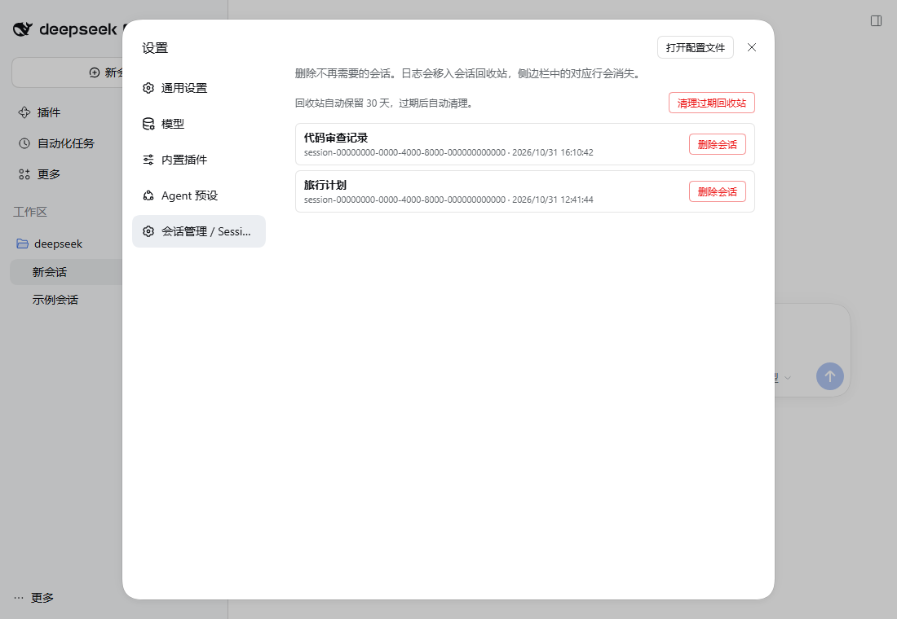
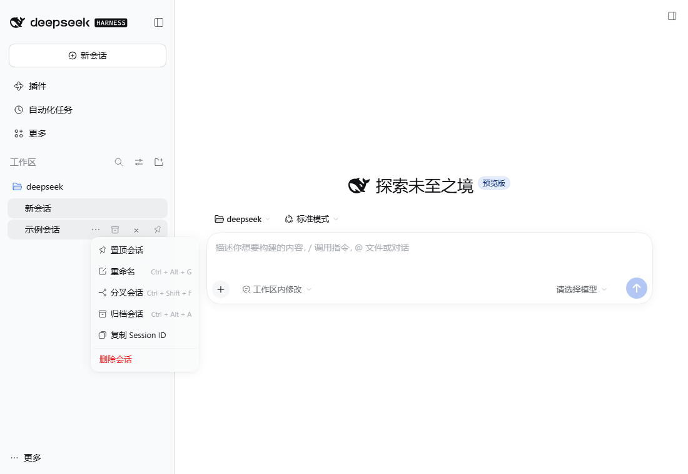

# dsh-safe-session-delete

[English](README.en.md) | 中文

给 DeepSeek Harness（DSH）Web 侧边栏加一个真正可用的「删除会话」入口。

DSH 原生只有**归档**，没有删除。这个插件补上删除能力：在会话行的 `...` 菜单、悬停按钮和「设置 → 会话管理」里加入删除入口，确认后由宿主端把会话日志移入回收站、清理投影缓存，并让列表立即刷新。

## 安装

从 GitHub Release 的预构建 tarball 安装（`<profile>` 换成 `desktop`、`web` 等）：

```powershell
dsh plugin --profile <profile> add "https://github.com/tz-Wang510/dsh-safe-session-delete/releases/download/v0.2.0/dsh-safe-session-delete-0.2.0.tgz"
```

如果本机 pnpm 报 `UNABLE_TO_VERIFY_LEAF_SIGNATURE`，在命令前设置 `$env:NODE_OPTIONS="--use-system-ca"` 再执行。

安装后重启 DSH。npm 包发布后会补充 `dsh plugin add dsh-safe-session-delete` 的安装方式。

## 截图





## 功能

- 会话行 `...` 菜单新增「删除会话」。
- 会话行悬停时右侧多一个红色 `×` 删除按钮，不用展开菜单。
- 「设置 → 会话管理」页面列出所有会话，每行一个「删除会话」按钮。
- 中英文界面自适应。
- 删除前弹出确认框，显示会话标题。
- 宿主端按会话 id 找到 JSONL 存储目录（`<DSH_HOME>/sessions/<项目目录>/<session-id>`）。
- 先归档会话并停止其正在运行的工作，再摘除内存中的 live 会话，最后移动日志，避免运行中的写入把文件重新创建出来。
- 同时删除该会话的投影缓存（`<DSH_HOME>/storages/session_projcache/sessions/<id>.json`），防止列表刷新时复用旧标题/旧行。
- 递归删除该会话的 subagent 子会话目录（侧边栏本来就不显示它们）。
- 日志不是直接抹掉，而是移动到 `<DSH_HOME>/session-trash/<时间戳>/<项目目录>/<session-id>/`，误删可手动找回。
- 回收站默认保留 **30 天**，过期批次在宿主启动时和之后每天自动清理；设置页可查看当前保留天数并手动清理。
- 删除成功后调用浏览器端 `sessions.refresh()`，当前列表立即更新。

## 使用

1. 重启 DSH（插件在启动时加载，安装/更新后需要重启一次应用）。
2. 任选一个入口：
   - 鼠标移到会话行，点右侧的 `...`，选「删除会话」；
   - 或直接点悬停时出现的红色 `×`；
   - 或打开 **设置 → 会话管理**，在列表里点「删除会话」。
3. 确认后，该行会从侧边栏消失。

当前正在主视图打开的会话也可以删除：确认框会额外提示，删除后该对话立即关闭、清除保存的选择并刷新页面。

## 回收站

删除后的日志位于：

```text
<DSH_HOME>/session-trash/
```

在 Windows 上通常是 `C:\Users\<你>\.dsh\session-trash\`。

确认不再需要时，可以手动清空：

```powershell
Remove-Item "<DSH_HOME>\session-trash" -Recurse -Force
```

插件默认在启动时和之后每 24 小时清理一次超过 30 天的批次。保留天数可以在 profile 的插件配置里改：

```yaml
- id: dsh-safe-session-delete
  name: dsh-safe-session-delete
  config:
    retentionDays: 30
```

`retentionDays: 0` 表示关闭自动清理，保留到手动清理为止。设置页的「清理过期回收站」按钮可以立即执行一次清理。

## 安装到其他 profile

在插件包目录执行（`<profile>` 换成 `desktop`、`web` 等）：

```powershell
dsh plugin --profile <profile> add "<插件目录>"
```

`dsh plugin add` 会把包加入 profile 的 `dependencies` 和 `dsh.profile.bundles`。确认 `package.json` 的 `dsh.profile.bundles` 中出现 `dsh-safe-session-delete`，然后重启 DSH。

如果修改了插件源码，需要让 profile 里的安装副本同步：先删除 `<profile>/node_modules/dsh-safe-session-delete`，再执行一次 `dsh plugin --profile desktop install`，或者直接把 `lib/` 覆盖到安装目录。pnpm 对本地 `file:` 依赖有缓存，只改版本号不一定会重新复制。

## 结构

```text
dsh-safe-session-delete/
  package.json              # dsh.bundle.patch + dsh.client 声明
  cordis.patch.yml          # 插入宿主插件行
  lib/index.js              # 宿主端：删除 / 清理 / 状态路由 + 每日保留策略
  lib/client.js             # 浏览器端：菜单项、悬停按钮、设置页
  test/verify-host.mjs      # 宿主删除与保留策略测试（临时目录）
  test/verify-client.mjs    # 浏览器端注册/请求测试（vm + 假 React）
  SECURITY.md               # 威胁模型与报告方式
  CHANGELOG.md              # 版本记录
  LICENSE                   # MIT
```

## 宿主路由

```http
POST /api/dsh-safe-session-delete/delete
Content-Type: application/json

{ "sessionId": "session-xxxx" }
```

成功返回：

```json
{ "ok": true, "deleted": ["session-xxxx"], "moved": ["..."], "purged": [] }
```

```http
GET  /api/dsh-safe-session-delete/status
POST /api/dsh-safe-session-delete/purge-trash
```

`status` 返回当前 `retentionDays`；`purge-trash` 立即删除过期批次并返回
`{ ok, retentionDays, removed, kept }`。

失败返回：

```json
{ "ok": false, "error": { "code": "NOT_FOUND", "message": "..." } }
```

路由通过 DSH 的 `connection.fetch.register` 挂载，因此和内置 API 一样受启动令牌 / 签名 Cookie 保护；非 owner Peer 会被拒绝。

## 测试

```powershell
npm test
```

或分别运行：

```powershell
node test/verify-host.mjs
node test/verify-client.mjs
```

宿主测试会在系统临时目录里构造假的会话目录，验证 id 校验、目录定位、子会话收集、移动回收站、投影缓存清理、30 天保留策略和 HTTP 响应；不会碰真实会话。浏览器端测试会加载真实 bundle，验证菜单/设置页注册和请求流程。

## 兼容性

- 已在 DSH `0.2.1-rc.5`（Desktop / Windows）上通过真实浏览器点击验证。
- 目标范围：DSH `>=0.2.1-rc.5 <0.3.0-0`，Node.js >= 20。
- DSH 插件 API 仍处于预览阶段；升级 DSH 后建议先跑一遍 `npm test` 并在隔离 profile 里试装。

## 已知限制

- 删除依赖 DSH 默认的 JSONL 存储布局（`dshHomePath('sessions')`）。如果 profile 把 `session-persistence-jsonl.root` 改到了别处，插件找不到目录，需要相应调整。
- 删除是尽力而为的宿主端文件操作，不是 DSH 官方持久化 API 的一部分；DSH 升级若改变存储布局，需要同步适配。
- 自动清理只在 DSH 运行时执行；长期不启动 DSH 时，过期批次会保留到下一次启动。
- 无法在应用内撤销；需要恢复时，把回收站里的会话目录移回原来的项目目录，再重启 DSH。
- 侧边栏行入口依赖 DSH 的 `sidebar.workspaces.session.menu.item` / `sidebar.workspaces.session.row.action` 官方 slot；设置页是更稳定的入口。

## License

MIT。见 [LICENSE](LICENSE)、[SECURITY.md](SECURITY.md)、[CHANGELOG.md](CHANGELOG.md) 和 [PUBLISHING.md](PUBLISHING.md)（发布前检查清单）。
